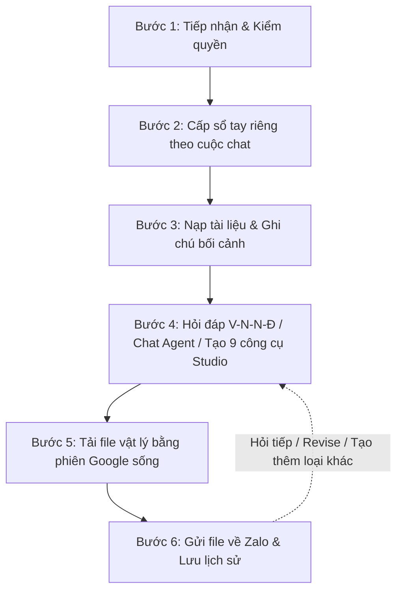

# Quy Trình Tích Hợp Zalo Agent -> Google Gemini Notebook (NotebookLM 10/2026)

Skill chuẩn hóa toàn bộ kiến trúc, quy trình 6 bước tích hợp giữa **Zalo Agent** và **Google Gemini Notebook (tên cũ trước 16/07/2026: NotebookLM – `notebook.google.com`)** chạy container Docker `roomi-fields/notebooklm-mcp` với Chrome Headless trên VPS, đồng thời tích hợp trọn bộ kiến thức thực chiến **Ấn bản 10/2026 (Giao diện mới 15/09/2026, Chat Agent Cloud Sandbox, 9 công cụ Studio & 115 Prompt tiếng Việt)**.

```
Chủ bot nhắn trên Zalo
  → Bot nạp tài liệu vào sổ tay Gemini Notebook riêng của cuộc chat
  → Hỏi đáp có trích dẫn / Chạy Chat Agent xuất file (Word, Excel, PPTX sửa chữ 100%)
  → Hoặc tạo 9 loại nội dung Studio chạy nền (Infographic, Audio, Video Explainer/Short/Cinematic, Slide, Báo cáo, Bảng dữ liệu, Mind Map, Flashcards, Quiz)
  → Tự động tải file bằng phiên Google sống (Cookie v10)
  → Gửi file trực tiếp về Zalo và ghi lịch sử hội thoại
```

> [!IMPORTANT]
> **Tài liệu tham chiếu chuyên sâu đi kèm trong thư mục `references/`:**
> - [`references/gemini-notebook-2026-guide.md`](file:///e:/OneDrive/HSCV/Antigravity/vbaibot/.agents/skills/zalo-agent-notebooklm/references/gemini-notebook-2026-guide.md): Cẩm nang kỹ thuật toàn tập 16 chương (3 nơi cùng tên Notebook, bảng gói cước Free/Plus/Pro/Ultra, hạn mức Compute làm mới mỗi 5 giờ, quy định Watermark tại Việt Nam, 9 công cụ Studio, Chat Agent chạy code & Từ điển giao diện Anh – Việt).
> - [`references/prompts-and-checklists.md`](file:///e:/OneDrive/HSCV/Antigravity/vbaibot/.agents/skills/zalo-agent-notebooklm/references/prompts-and-checklists.md): Công thức đặt câu hỏi **V–N–N–Đ**, **Thư viện 115 Prompt tiếng Việt** chia theo 10 nhóm tính năng, **8 Quy trình mẫu theo nghề** và **5 Checklist kiểm chứng chống ảo giác**.

---

## 1. NGUYÊN TẮC CỐT LÕI XUYÊN SUỐT (CROSS-CUTTING PRINCIPLES)

1. **Không chính thức (Unofficial Reverse-Engineered Engine)**:
   - Máy chủ Gemini Notebook điều khiển Chrome bằng phiên Google thật.
   - Bắt buộc dùng tài khoản Google phụ/chuyên dụng (đã xác minh **18+** để mở khóa *Deep Research, Infographic, Slide Deck, Video Cinematic, Visual Style*), **tuyệt đối không dùng tài khoản Google cá nhân chính**.
2. **Mặc định chỉ Chủ bot (Owner-Only Access)**:
   - Người lạ / thành viên thông thường không thấy tool trong schema.
   - Chỉ mở cho mọi người khi cấu hình tường minh `NOTEBOOKLM_PUBLIC = true` trong Dashboard/DB.
3. **Chỉ mở trong máy nội bộ (Localhost Only)**:
   - REST API của máy chủ NotebookLM không có cơ chế xác thực bí mật nên cổng `3000` **chỉ nghe tại `127.0.0.1`**.
   - Cổng noVNC `6080` chỉ mở trên IP VPN nội bộ (Tailscale) khi cần quản trị viên đăng nhập Google ban đầu.
4. **Đo thật - Không tin tài liệu lý thuyết (Reality-Driven Architecture)**:
   - Giao diện Gemini Notebook đã cập nhật đợt lớn ngày `16/07/2026` (đổi tên) và `15/09/2026` (New UI) cùng cơ chế hạn mức **Compute làm mới mỗi 5 giờ** (`02/09/2026`).
   - Bot chỉ sử dụng các luồng, endpoint và cấu trúc đã chạy nghiệm thu thành công thực tế.
5. **Tuyệt đối không nuốt câm (Never Fail Silently)**:
   - Nguồn lỗi, link hết hạn, chạm trần Compute 5 giờ hoặc phiên Google bị văng đều phải có câu thông báo nguyên nhân kỹ thuật rõ ràng; tác vụ dở dang được ghi nhận để người dùng thử lại hoặc lấy lại.

---

## 2. NỀN TẢNG HẠ TẦNG DÙNG CHUNG (SHARED INFRASTRUCTURE)

| Thành phần | Vai trò & Đặc tả kỹ thuật |
|:---|:---|
| **`roomi-fields/notebooklm-mcp`** | Docker container chạy trên VPS, cung cấp REST API nội bộ tại `http://127.0.0.1:3000`. |
| **Chrome Headless + noVNC** | Trình duyệt Chrome thật chạy ngầm điều khiển `notebook.google.com` (đã cài `Output Language = Tiếng Việt` và bật `Web notifications`); đăng nhập qua noVNC (port 6080 Tailscale). |
| **`extractDocumentText`** | Module trích xuất văn bản từ tài liệu PDF (kể cả PDF scan qua Vision OCR), Word (`.docx`), Excel (`.xlsx`), PowerPoint (`.pptx`). |
| **`describeImage`** | Mô tả nội dung hình ảnh qua Vision AI (Providers > Vision) trước khi nạp dạng text. |
| **`ffmpeg`** | Chuyển đổi định dạng âm thanh từ Apple M4A sang chuẩn MP3 tương thích hoàn hảo với Zalo PC và Mobile. |
| **Hàng đợi tuần tự + Trần ngày** | Module `notebooklm-jobs` điều phối 1 job/thời điểm; `notebooklm-store` kiểm soát trần `NOTEBOOKLM_MAX_PER_DAY` (mặc định 5 lượt tạo/ngày) tương thích với chu kỳ **Compute 5 giờ** của Google. |
| **Giám sát liveness 5 phút** | Module `notebooklm-health` quét định kỳ mỗi 5 phút; nếu mất kết nối hoặc mất cookie thì báo ngay vào Việc cần làm trên App + Nhật ký. |

---

## 3. QUY TRÌNH 6 BƯỚC CHI TIẾT (END-TO-END PIPELINE)



---

### BƯỚC 1: Yêu Cầu Được Nhận Và Qua Cổng Kiểm Quyền (Tức Thì)

- **Người dùng đưa**:
  * Câu lệnh rõ việc muốn làm: nạp nguồn (`them_nguon`), hỏi đáp hoặc nhờ Chat Agent phân tích/xuất file (`hoi`), tạo nội dung Studio (`tao`), lấy lại file (`lay`), xem danh sách (`danh_sach`).
  * File tài liệu (PDF, Word, Excel, CSV, PPT, ảnh, âm thanh), link web hoặc link YouTube đính kèm cùng lượt.
- **Bot làm**:
  * Model chọn action phù hợp của tool `notebooklm`: `them_nguon` | `hoi` | `tao` | `lay` | `danh_sach`.
  * Đọc lại cấu hình `NOTEBOOKLM_API_URL` và hạn mức trần ngày từ database / dashboard.
- **Chốt chặn (Code kiểm tra, cấm nhờ AI suy luận)**:
  * **Cửa 1**: Tool `notebooklm` không xuất hiện trong schema nếu chưa cấu hình máy chủ, hoặc người gửi không phải chủ bot (trừ khi bật `NOTEBOOKLM_PUBLIC = true`).
  * Trong nhóm Zalo: Chỉ kích hoạt nếu toàn bộ các tin nhắn trong batch đều là của chủ bot.
  * **Cửa 2**: Khi tool execute, kiểm tra lại database lần thứ hai để chặn bypass.
  * **Kiểm trần**: Kiểm tra hạn mức `NOTEBOOKLM_MAX_PER_DAY` của cuộc chat (mặc định 5 lượt tạo/ngày) và trần toàn bot `NOTEBOOKLM_MAX_PER_DAY_GLOBAL` (mặc định 30 lượt/ngày).
- **Mẫu lệnh kiểm thử**: *"Tạo Infographic tóm tắt file PDF này giúp anh"*

---

### BƯỚC 2: Mỗi Cuộc Chat Có Một Sổ Tay Riêng (Lần Đầu 5 - 10 Giây)

- **Bot làm**:
  * Tra cứu bảng `notebooklm_notebooks` theo `thread_key` (`accountId:threadId`).
  * Nếu chưa có sổ tay: Gọi `POST /notebooks/create`, lưu `notebook_id` và `notebook_url` vào cơ sở dữ liệu SQLite.
  * Mọi lời gọi API tiếp theo **BẮT BUỘC gửi kèm `notebook_url`** trong payload (do endpoint `PUT /activate` của container không hoạt động ổn định).
- **Trả về**:
  * `notebook_url` duy nhất gắn chặt với cuộc chat đó.
- **Chốt chặn**:
  * Mọi lời gọi tới máy chủ Gemini Notebook phải xếp hàng qua hàng đợi tuần tự (`notebooklm-queue`) vì container chỉ có một phiên Chrome điều khiển.
  * Tuân thủ nguyên tắc vàng: **Một chủ đề / Một câu hỏi lớn = Một sổ tay riêng** (tránh nhồi tài liệu khác lĩnh vực gây nhiễu ngữ cảnh).

---

### BƯỚC 3: Tài Liệu Được Nạp Vào Sổ Tay (Vài Giây Đến 1 Phút Mỗi Nguồn)

- **Người dùng đưa**:
  * Chữ dán trực tiếp trong tin nhắn, đường link website, link video YouTube (công khai, có phụ đề, đã đăng ≥ 72 giờ).
  * File đính kèm: PDF (text hoặc scan), Word (`.docx`), Excel (`.xlsx`), dữ liệu bảng (`.csv`), PowerPoint (`.pptx`), ảnh, ghi âm.
  * Hoặc yêu cầu tìm nguồn tự động qua **Fast Research** / **Deep Research**.
- **Bot làm**:
  * Với chữ, link web, YouTube: Gửi `POST /content/sources` đúng tham số loại nguồn (`text`, `url`, `youtube`).
  * Với FILE đính kèm: Bot tự động trích xuất toàn bộ text bằng `extractDocumentText` (tự động OCR nếu là PDF scan), ảnh được mô tả bằng Vision AI `describeImage`, sau đó nạp vào Gemini Notebook dưới dạng nguồn text (hoặc giữ định dạng bảng CSV khi cần chạy phân tích dữ liệu).
  * Giữ nguyên tên file rõ ràng làm tiêu đề nguồn (`title`) để trích dẫn chuẩn xác.
  * Có thể khởi tạo kèm ghi chú **`00 – Bối cảnh`** (mục tiêu, đối tượng người đọc, quy chuẩn đầu ra) và chuyển thành nguồn (`Convert to source`) để định hướng toàn bộ câu trả lời về sau.
- **Trả về**:
  * Danh sách các nguồn đã nạp thành công + danh sách nguồn lỗi kèm nguyên nhân chi tiết.
- **Chốt chặn**:
  * Tối đa 5 tệp mỗi lượt gửi qua bot; cắt giới hạn tối đa 400.000 ký tự cho mỗi nguồn nạp qua API (giới hạn gốc của Gemini Notebook là 500.000 từ hoặc 200MB/nguồn; 50 nguồn ở gói Free, 300 nguồn ở gói Pro, 500–600 nguồn ở gói Ultra).
  * Không sử dụng endpoint upload file trực tiếp của container nếu đường dẫn máy chủ không đồng bộ; tệp không trích xuất được chữ phải báo rõ lý do, tuyệt đối không im lặng.
- **Mẫu lệnh kiểm thử**: *"Nạp 3 file này vào sổ tay rồi tóm tắt cho anh"*

---

### BƯỚC 4: Hỏi Đáp Có Trích Dẫn, Chat Agent Xuất File Hoặc Tạo Nội Dung Studio Chạy Nền

*Thời gian thực thi thực tế (Cập nhật 10/2026):*
- *Hỏi đáp (`POST /ask`): 10 – 30 giây.*
- *Chat Agent chạy code phân tích CSV & xuất file (`.docx`, `.xlsx`, `.pptx`, `.pdf`): 30 – 90 giây.*
- *Infographic / Mind Map / Flashcards / Quiz / Data Table / Reports: 60 – 120 giây.*
- *Audio Overview (Podcast 4 định dạng): ~5 phút.*
- *Video Overview (`Explainer`, `Short` dọc 60s, `Cinematic`): **10 – 35+ phút** (Theo Google, Video Overview có thể mất **hơn 30 phút** để hoàn tất).*

- **Người dùng đưa**:
  * Câu hỏi phân tích tài liệu (ưu tiên cấu trúc 4 phần **V–N–N–Đ**: *Vai trò – Nhiệm vụ – Nguồn – Định dạng*).
  * Yêu cầu **Chat Agent** phân tích số liệu, vẽ biểu đồ hoặc xuất file **PowerPoint (`.pptx` chữ sửa được 100%)**, **Excel (`.xlsx` nhiều sheet)**, **Word (`.docx`)**, **PDF**.
  * Hoặc loại sản phẩm Studio muốn tạo: `infographic`, `podcast`, `video`, `slides`, `bang_du_lieu`, `bao_cao`, `flashcards`, `quiz`, `mind_map`.
- **Bot làm**:
  * **Hỏi đáp & Chat Agent**: Gửi `POST /ask`, nhận câu trả lời kèm danh sách trích dẫn nguồn (`sources.citations`), `thinking steps` (nếu chạy code) và link file sinh ra từ Cloud Sandbox.
  * **Tạo Studio**: Trả lời ngay vào chat Zalo thông báo "đang xử lý", xếp công việc vào background queue rồi gọi `POST /content/generate` (block cho tới khi hoàn tất).
  * So sánh danh sách nội dung Studio TRƯỚC và SAU khi tạo để xác định chính xác mục mới sinh ra.
- **Đặc tả tùy chỉnh theo từng loại sản phẩm (Chuẩn 10/2026)**:
  1. **Audio Overview (`podcast`)**: Chọn 1 trong 4 định dạng: `Deep Dive` (đào sâu 2 host), `Brief` (tóm tắt < 2 phút), `Critique` (nhận xét/góp ý), `Debate` (tranh luận 2 chiều). Với tiếng Việt, ghi rõ thời lượng mong muốn trong `yeuCau`.
  2. **Video Overview (`video`)**: Chọn 1 trong 3 định dạng:
     - `Explainer`: Giải thích toàn diện có thuyết minh tiếng Việt + 9 phong cách hình (`Classic`, `Whiteboard`, `Watercolor`, `Retro Print`, `Heritage`, `Paper-craft`, `Kawaii`, `Anime`, `Custom`).
     - `Short` *(Mới 2026)*: **Video dọc ~60 giây (tỷ lệ 9:16)** kết hợp thuyết minh và hoạt họa giáo dục, tối ưu cho Reels, TikTok, YouTube Shorts.
     - `Cinematic`: Phim điện ảnh (yêu cầu gói Pro/Ultra, 18+, tiếng Anh).
  3. **Infographic (`infographic`)**: Chọn hướng giấy (`Portrait` dọc, `Landscape` ngang, `Square` vuông), mức chi tiết **`Concise` (Ngắn gọn – khuyên dùng cho tiếng Việt để tránh lỗi sai dấu chữ)**, `Standard` hoặc `Detailed`, và 10 phong cách hình (`Sketch Note`, `Professional`, `Bento Grid`, `Editorial`...).
  4. **Slide Deck (`slides`) vs. Chat Agent PowerPoint**:
     - Tạo từ **Studio (`slides`)**: Có 2 chế độ `Detailed Deck` (chi tiết để đọc) và `Presenter Slides` (gọn để thuyết trình), hỗ trợ `Review outline notes` và `Revise` từng slide. Tuy nhiên chữ thường bị "dính" vào hình nền.
     - Tạo từ **Chat Agent**: Khi người dùng cần **file `.pptx` chỉnh sửa được từng chữ 100%**, yêu cầu trực tiếp trong khung Chat để Cloud Sandbox xuất file PowerPoint thuần văn bản.
  5. **Reports (`bao_cao`) & Data Table (`bang_du_lieu`)**:
     - Báo cáo có 2 format: `Document` (`Briefing Doc`, `Study Guide`, `FAQ`, `Create your own`) và `Interactive` (`Learning Overview` nhúng sẵn Quiz/Flashcards/Video).
     - `Data Table` xuất ra Google Sheets gồm **2 tab** (Tab 1: Bảng dữ liệu; Tab 2: `Citations` trích dẫn nguồn).
  6. **Flashcards & Quiz**: Tùy chỉnh số lượng (`Fewer`/`Standard`/`More`) và độ khó (`Easy`/`Medium`/`Hard`); Flashcards xuất được file `CSV` cho Anki/Quizlet; Quiz hỗ trợ cả chọn nhiều đáp án (`Multiple select`), trả lời ngắn (`Short answer`) và điền từ (`Fill in the blank`).
- **Chốt chặn**:
  * Câu trả lời từ Gemini Notebook được bọc qua `wrapUntrustedContent` (coi là dữ liệu tham chiếu bên ngoài, không phải chỉ thị hệ thống).
  * Toàn hệ thống chỉ cho phép 1 tác vụ sinh Studio chạy tại một thời điểm; nếu job thất bại thì tự động hoàn lại hạn mức trong ngày (`refundGeneration`).
- **Mẫu lệnh kiểm thử**: *"Làm podcast 2 người tranh luận (Debate) về tài liệu này"* hoặc *"Tạo video dọc Short 60 giây giải thích quy trình trong văn bản"*

---

### BƯỚC 5: File Được Tải Về Bằng Phiên Google Sống (Vài Giây)

- **Bot làm**:
  * Gọi `GET /content` để trích xuất `mediaUrl` của sản phẩm vừa tạo (hoặc lấy link tải file từ phản hồi của Chat Agent).
  * Đọc **COOKIE SỐNG** trực tiếp từ hồ sơ Chrome của container (giải mã file `Cookies` SQLite theo cơ chế v10), tuyệt đối không dùng `state.json` đã lưu từ trước.
  * Xử lý định dạng đầu ra:
    * **Audio**: Tải file M4A về, chuyển đổi sang `MP3` bằng `ffmpeg`.
    * **Infographic & Mind Map**: Tải file `PNG` độ phân giải cao (lưu ý: ảnh/video tạo tại Việt Nam luôn có watermark hiển thị tự động của Google theo quy định vùng, tuyệt đối không xóa).
    * **Video (`Explainer` / `Short` / `Cinematic`)**: Tải file `MP4`.
    * **Slide**: Tải file `PPTX` hoặc `PDF` (từ Studio hoặc từ Chat Agent).
    * **Bảng dữ liệu / Flashcards**: Xuất file `Excel (.xlsx)` / `CSV` hoặc gửi link Google Sheets 2 tab (Data + Citations).
    * **Báo cáo phân tích**: Lưu ra file `.docx`, `.pdf` hoặc `.md`.
- **Trả về**:
  * File vật lý: `PNG infographic`, `MP3 audio`, `MP4 video`, `PPTX slide`, `XLSX/CSV bảng dữ liệu`, `DOCX/PDF/MD báo cáo` hoặc đường link Google Docs/Slides/Sheets.
- **Chốt chặn**:
  * Nếu link trả về 404 hoặc 5xx: Thử lại tối đa 6 lần, mỗi lần cách nhau 20 giây; nếu phản hồi là trang HTML đăng nhập thì xác định phiên Google đã hết hạn, lập tức dừng lại và thông báo lỗi.
  * Chỉ chấp nhận tải file từ các host chính thức của Google qua giao thức HTTPS.

---

### BƯỚC 6: Kết Quả Về Zalo, Ghi Lịch Sử, Cho Phép Xin Lại (Tức Thì)

- **Bot làm**:
  * Gửi file trực tiếp vào cuộc chat Zalo qua hàm `deliverFile`, đồng thời ghi thẳng vào lịch sử tin nhắn của cuộc trò chuyện (vì lượt chat ban đầu đã kết thúc).
  * Nếu quá trình tạo/tải thất bại: Nhắn tin thông báo ngắn gọn nêu đúng lý do kỹ thuật, không nuốt câm.
  * Nhận lệnh xin lại (`action: "lay"`): Gửi lại file mới nhất cùng loại đã tạo sẵn trong sổ tay mà **không trừ thêm hạn mức ngày**.
- **Trả về**:
  * File đính kèm trên Zalo + Dòng ghi chú lịch sử hệ thống (để bot nhớ ngữ cảnh ở các lượt tiếp theo).
- **Chốt chặn**:
  * Module giám sát `notebooklm-health` chạy mỗi 5 phút: Nếu máy chủ không phản hồi, mất phiên đăng nhập Google hoặc không đọc được cookie, lập tức đẩy cảnh báo vào mục Việc cần làm trên ứng dụng điện thoại + log hệ thống.
- **Mẫu lệnh kiểm thử**: *"Gửi lại file audio vừa tạo"*

---

## 4. BẢNG TỔNG HỢP CÁC ACTION CỦA TOOL `notebooklm`

| Action | Tham số chính | Mục đích sử dụng | Hành vi hệ thống |
|:---|:---|:---|:---|
| **`them_nguon`** | `fileUrl`, `fileNames`, `urls`, `text` | Nạp tài liệu mới hoặc ghi chú bối cảnh vào sổ tay của cuộc chat. | Trích xuất text (hoặc giữ bảng CSV), gọi `/content/sources`, trả về danh sách nguồn đã nạp. |
| **`tao`** | `loai` (`infographic`, `podcast`, `video`, `slides`, `bang_du_lieu`, `bao_cao`, `flashcards`, `quiz`, `mind_map`), `yeuCau` | Yêu cầu Studio sinh sản phẩm đa phương tiện hoặc học liệu tương tác. | Báo ngay "đang làm", chạy background job (timeout Video tới 40 phút), tải file qua cookie sống, gửi thẳng vào Zalo khi xong. |
| **`hoi`** | `cauHoi` | Hỏi đáp đối chiếu dữ liệu có trích dẫn (theo công thức V–N–N–Đ) hoặc yêu cầu **Chat Agent** chạy code phân tích CSV / xuất file Word, Excel, PPTX chữ sửa được 100%. | Gọi `/ask`, kiểm chứng 3 lỗi trích dẫn (*gộp ý, bỏ điều kiện, thiếu số trích dẫn*), trả về câu trả lời kèm nguồn hoặc file xuất ra. |
| **`lay`** | `loai` | Tải và gửi lại sản phẩm Studio đã tạo trước đó. | Tìm trong Studio của sổ tay, tải và gửi lại file mà không tốn quota. |
| **`danh_sach`** | *không có* | Xem danh sách nguồn và sản phẩm Studio hiện có. | Liệt kê các file/nguồn đã nạp và trạng thái sản phẩm trong sổ tay. |

---

## 5. BỘ QUY TẮC PHÒNG CHỐNG LỖI & ẢO GIÁC (GUARD RULES)

1. **Tuyệt đối cấm tự gõ nhãn trạng thái trong ngoặc vuông**:
   - Các nhãn như `[Đã gửi infographic từ NotebookLM]`, `[Đã gửi tin nhắn thoại tổng hợp ~ ...]` **CHỈ ĐƯỢC PHÉP SINH RA BỞI HỆ THỐNG** sau khi background job hoàn thành và gửi file thành công vào Zalo.
   - LLM tuyệt đối không được tự gõ các nhãn này vào nội dung phản hồi trong khung chat.
2. **Cấm tự viện cớ từ chối**:
   - Tuyệt đối không trả lời: *"Em là trợ lý Zalo không truy cập được tài khoản Google cá nhân của anh"*.
   - Tuyệt đối không bịa lý do: *"Server tạo ảnh đang bảo trì"* để né tránh làm Infographic từ tài liệu.
   - Hệ thống đã tích hợp sẵn máy chủ Gemini Notebook headless trên VPS, bot tự nạp và tự tạo được 100%.
3. **Phân định rõ Infographic tài liệu vs. Vẽ ảnh nghệ thuật**:
   - Khi người dùng yêu cầu làm Infographic / tóm tắt tài liệu dạng trực quan: **BẮT BUỘC gọi `notebooklm` (`action: 'tao'`, `loai: 'infographic'`)**, ưu tiên dặn mức chi tiết `Concise` và câu chữ ngắn gọn để không bị lỗi dấu tiếng Việt; tuyệt đối không dùng tool `create_image`.
   - Tool `create_image` chỉ dùng khi người dùng nhờ vẽ tranh ảnh nghệ thuật, poster đơn thuần không gắn với bóc tách tài liệu.
4. **Phân định rõ Slide Studio vs. PowerPoint chỉnh sửa 100% chữ**:
   - Nếu người dùng cần slide trình chiếu nhanh có đồ họa đồng bộ: dùng `action: "tao"`, `loai: "slides"` (`Presenter Slides` hoặc `Detailed Deck`).
   - Nếu người dùng yêu cầu **file PowerPoint (`.pptx`) chỉnh sửa được 100% từng chữ**: hướng dẫn hoặc gọi qua **Chat Agent (`action: "hoi"`)** với prompt yêu cầu tạo file `.pptx` văn bản thuần.
5. **Bắt buộc điền tham số `yeuCau` chuẩn xác khi tạo Studio**:
   - Khi gọi `action: "tao"`, luôn nêu rõ: (1) **Tên/số hiệu văn bản** cần tập trung, (2) **Định dạng con** (ví dụ: Audio `Deep Dive`/`Brief`/`Critique`/`Debate`; Video `Explainer`/`Short 60s dọc`/`Cinematic`; Infographic `Portrait`/`Landscape` + `Concise`), và (3) **Đối tượng người xem** (tham khảo 115 mẫu prompt tại [`references/prompts-and-checklists.md`](file:///e:/OneDrive/HSCV/Antigravity/vbaibot/.agents/skills/zalo-agent-notebooklm/references/prompts-and-checklists.md)).
6. **Kiểm chứng chống ảo giác 3 lớp**:
   - Luôn đối chiếu câu trả lời với số trích dẫn `①, ②`; cảnh giác 3 lỗi ngụy tạo phổ biến của AI: **Gộp hai ý rời rạc thành một kết luận mới**, **Bỏ điều kiện giới hạn của câu gốc**, và **Đưa nhận định không có số trích dẫn**.
